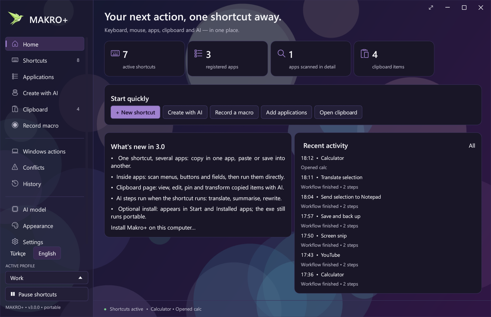
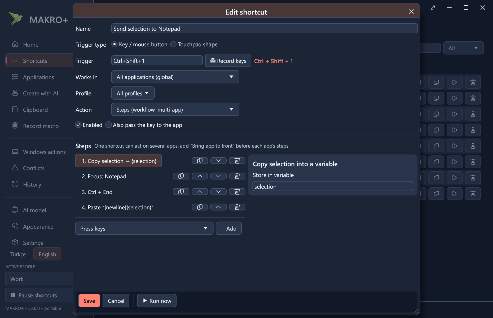
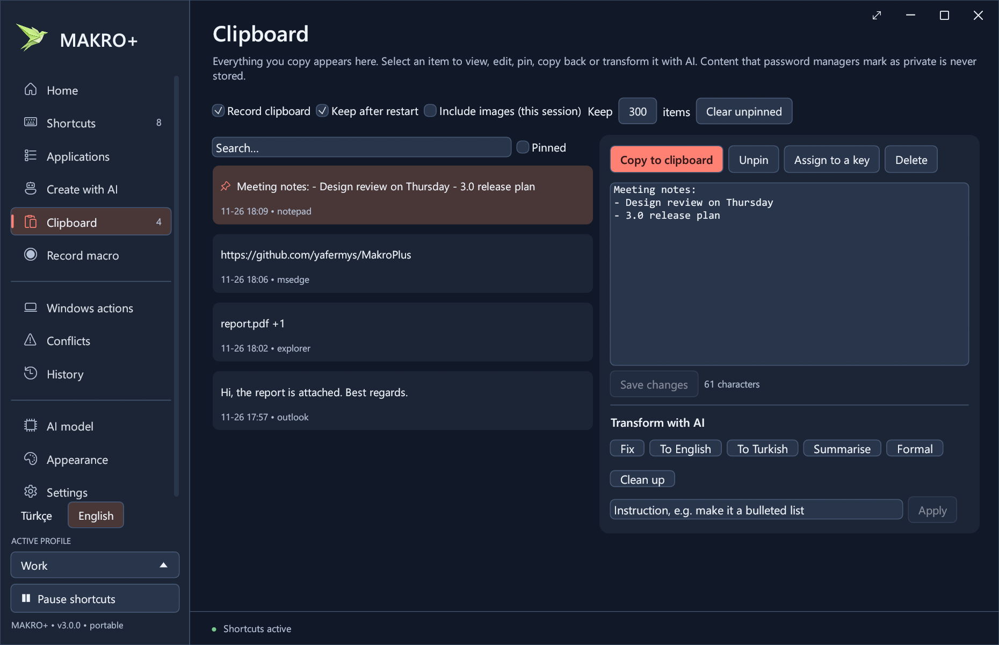
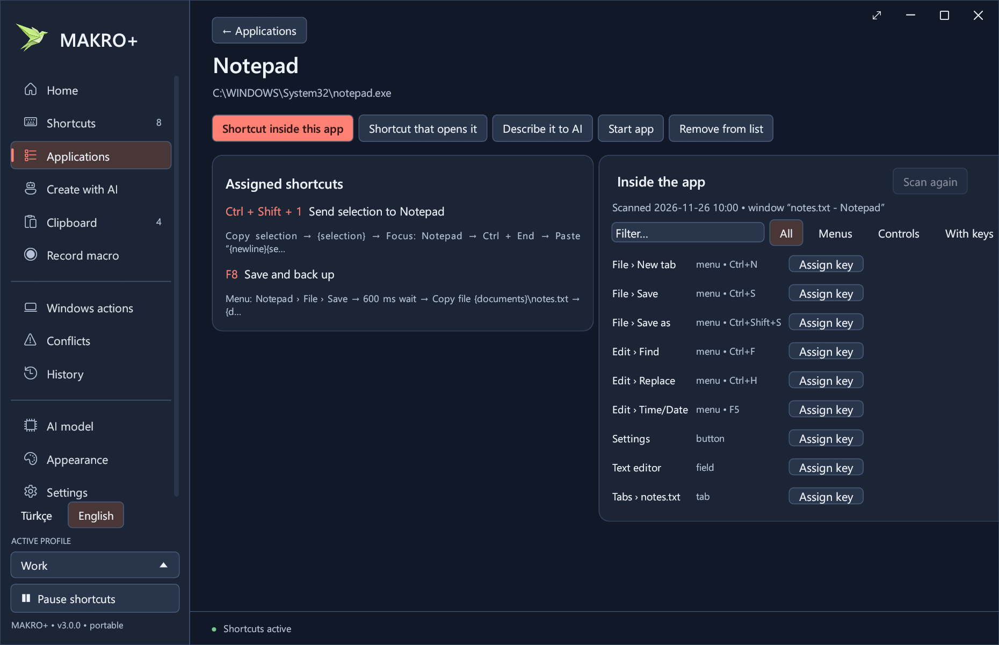

# Makro+

**Your next action, one shortcut away.**

Turn keyboard combinations, mouse buttons and touchpad shapes into actions that
work across your apps: copy from one app and save into another, run menu commands
inside an app, transform text with AI, or keep a searchable clipboard. Use it in
**English or Türkçe**, on **Windows and Linux**.

**[Download Makro+ 3.0.1 for Windows x64](https://github.com/yafermys/MakroPlus/releases/download/v3.0.1/MakroPlus-3.0.1-win-x64.zip)** · [Linux packages](https://github.com/yafermys/MakroPlus/releases/tag/v3.0.1) · [Release notes](https://github.com/yafermys/MakroPlus/releases/tag/v3.0.1)

Windows 10/11 x64 · Linux x86_64 (.deb, .rpm, AppImage, .tar.gz) · Native Rust app, no .NET · GPL-3.0-only



## Get started

1. **Download and run.** On Windows, extract the ZIP and open `MakroPlus.exe`
   (portable), or run `Install.cmd` to add it to Start and *Installed apps*.
   On Linux, install the `.deb`/`.rpm` or run the AppImage.
2. **Add a shortcut.** Choose **New shortcut**, record the keys (or draw a
   touchpad shape), pick what should happen, save.
3. **Or describe it.** **Create with AI** turns a sentence into a reviewed plan.

Makro+ 2.x shortcuts are imported automatically on first start.

## What you can do

| Task | How Makro+ helps |
| --- | --- |
| Work across apps | One shortcut can copy the selection, switch to another app (starting it if needed), paste, save, wait for a window and copy or move files. |
| Go inside apps | Scan an app's menus, buttons and fields, then assign any of them to a key (Windows). |
| Keep your clipboard | View, search, pin and edit copied items; copy them back, transform them with AI or turn them into a paste shortcut. |
| Use AI | Plan shortcuts from a sentence, or add AI steps that translate, fix or summarise text when the shortcut runs. Bring your own GGUF model or API server. |
| Trigger your way | Keys, two-key chords (Del+5), mouse buttons and wheel, or touchpad shapes. Switch a key's own function off without deleting it. |
| See what's available | Hold Right Ctrl to show the shortcuts of the app in front; choose what the guide lists. |
| Make it yours | 16 themes, your own themes, and an image, GIF or video background with an automatic matching theme. |



## Clipboard and in-app commands





## Optional AI

Choose **Create with AI**, describe the action, review the plan, then save:

```text
When I press Ctrl+Alt+T, translate the selected text to English and paste it.
When I press F9, save this file and copy it to Documents\Backup.
Ctrl+Shift+1: copy the selection, switch to Notepad and paste it on a new line.
```

Put a GGUF model into `models` next to the app, or connect any OpenAI-compatible
API server in **AI model**. Model weights are never bundled or downloaded. API
mode sends prompts and app names to the server you choose. Saved shortcuts do not
need the model, except their AI steps.
[Recommended model](docs/RECOMMENDED_MODEL.md).

## Linux

Makro+ reads input through evdev and sends keys through uinput, on X11 and
Wayland. Add your user to the `input` group once and log in again; the packages
install the needed udev rule. Swallowing keys is opt-in (*Exclusive mode*);
app-specific shortcuts need X11, Sway or Hyprland; scanning controls inside apps
is Windows-only for now. Details: [release notes](docs/releases/3.0.0.md).

## Help, limits and source

- **Updates:** Makro+ checks for a new release each time it starts (Settings ›
  App updates). It never downloads or installs anything by itself.
- **Report a problem:** [open an issue](https://github.com/yafermys/MakroPlus/issues/new/choose)
  with your OS and app version. Keep API keys and private settings out of reports.
- **Downloads** are unsigned; verify them with the matching `.sha256` file.
- **Source:** [matching source ZIP](https://github.com/yafermys/MakroPlus/releases/download/v3.0.1/MakroPlus-3.0.1-source.zip),
  [build and contribute](CONTRIBUTING.md), [changes](CHANGELOG.md),
  [security](SECURITY.md), [third-party licenses](THIRD_PARTY_NOTICES.md).
  Makro+ 3 lives in `rust/`; the 2.x C# app remains in `src/`.

Makro+ is licensed under **GPL-3.0-only**. Runtime components and optional models have their own licenses.
