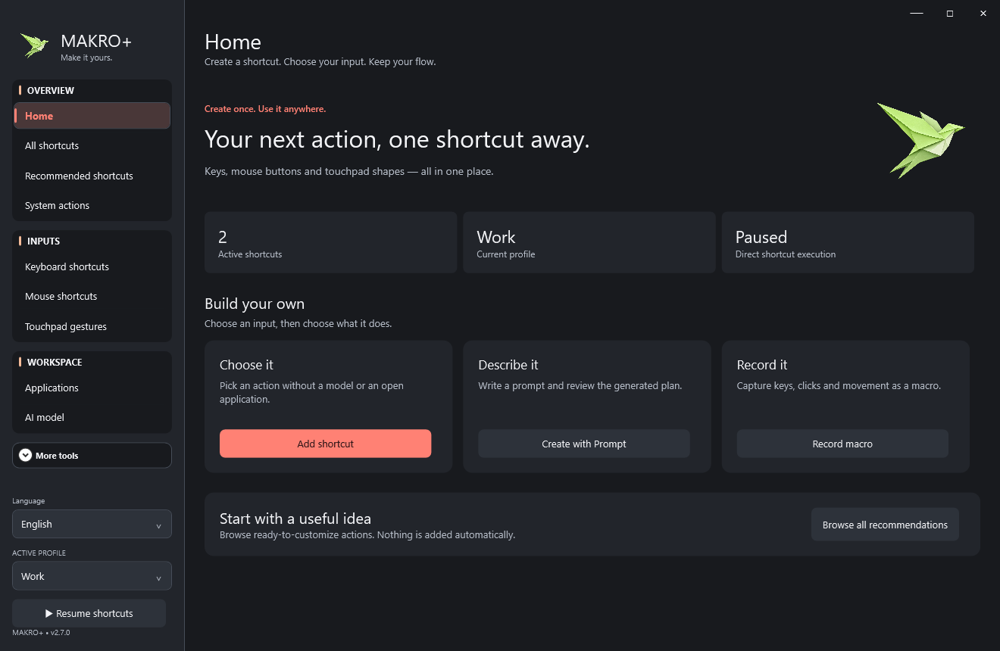
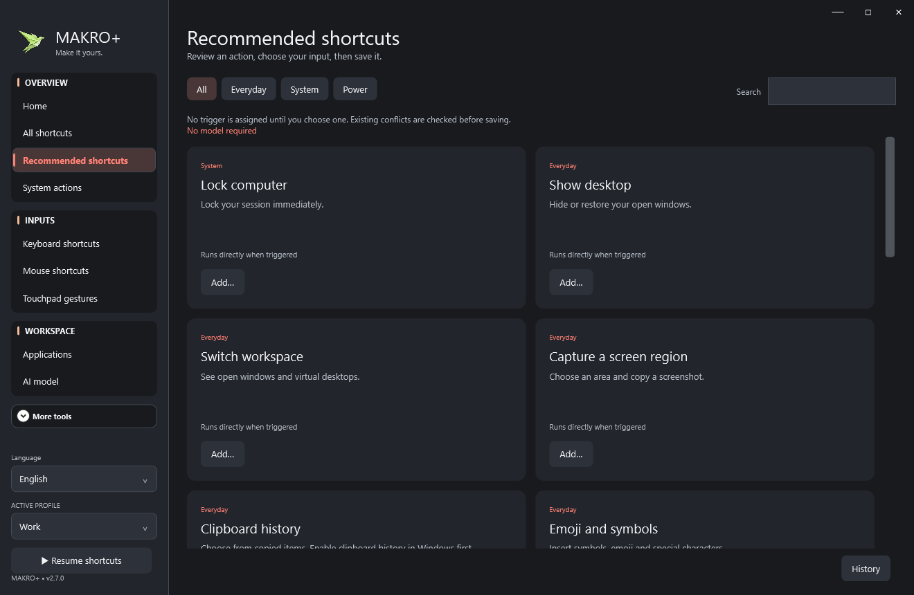

# Makro+

**Your next action, one shortcut away.**

A Windows app that turns keyboard combinations, mouse buttons and touchpad shapes into useful actions. Open apps, automate a routine, or control Windows. Use it in **English or Türkçe**.

**[Download Makro+ 2.7.0 for Windows x64](https://github.com/yafermys/MakroPlus/releases/download/v2.7.0/MakroPlus-2.7.0-win-x64.zip)** · [Release notes](https://github.com/yafermys/MakroPlus/releases/tag/v2.7.0)

Windows 10/11 x64 · .NET Framework 4.8 · GPL-3.0-only · No bundled language model



## Get started

1. **Download and extract the entire Windows ZIP.** Open `MakroPlus.exe`, or run `Install.cmd` for a per-user installation.
2. **Choose your language** in the sidebar. Open **Add shortcut** to create your own assignment, or **Recommended shortcuts** to start with a ready-made action.
3. **Choose your input and save.** Use a keyboard combination, mouse button/wheel, or a recorded touchpad shape. Review the action and any conflicts first.

Applications can be closed while you create their shortcuts. Saved assignments run directly, without a model request. Read `START_HERE.txt` and the offline `USER_GUIDE.html` included in the ZIP for detailed setup and examples.

## What you can do

| Task | How Makro+ helps |
| --- | --- |
| Launch and navigate | Open applications, websites, files and desktop app links. |
| Automate a routine | Record and edit keys, text, clicks, scrolling and waits. |
| Control Windows | Lock your session, check updates, or request shutdown, restart and closure of open apps. |
| Start quickly | Customize 16 recommendations for screenshots, clipboard history, window navigation, settings and more. |
| Keep things organized | Use profiles, app-specific scopes, input pages and conflict checks. |
| Make it yours | Choose a light/dark theme, create a palette, and import or export settings. |

Shutdown, restart and closing open applications ask for confirmation when triggered. Close requests respect save prompts and do not force-kill apps. Update checks search for available updates; they do not download or install them. Windows policies and application permissions may restrict some operations.



## Optional: create shortcuts with a prompt

Choose **Create with Prompt**, describe the action in English, review the plan, then save it. For example:

```text
When I press Ctrl+Alt+F6, check Windows updates.
When I press F8, select all text and copy it.
Open https://www.youtube.com/ in Brave when I press Del+5.
```

Example keys are suggestions; check for conflicts on your computer. For touchpad shortcuts, record a shape first and describe only its action. Generating a preview does not run the plan.

**Bring your own model:** copy a compatible GGUF into `models` next to `MakroPlus.exe`, then select it in **AI model → Configure model**. You can also use a compatible chat-completions API server. Model weights are never bundled or downloaded automatically.

**Recommended tested model: [Qwen3.5-4B Q4_0 GGUF — download and setup](docs/RECOMMENDED_MODEL.md).** It is optional; other supported local models and API model IDs remain selectable. The first local request loads the model; saved shortcuts do not need it loaded. API mode sends prompts and application context to your chosen server.

## Help, limits and source

- **[Complete user guide](packaging/USER_GUIDE.html):** setup, prompts, inputs, system actions, themes, backup and troubleshooting. Open the downloaded copy offline in your browser.
- **[Report a problem](https://github.com/yafermys/MakroPlus/issues/new/choose):** include your Windows/app version and steps to reproduce it. Keep API keys and private settings out of reports.
- **Hardware:** standard Windows keys, five mouse buttons and wheel directions are supported. Firmware-only Fn keys and vendor-specific buttons depend on the driver. Continuous touchpad shapes use Precision Touchpad input or a calibrated pointer source; recognition quality varies by device.
- **Downloads:** this Windows build is unsigned. The ZIP includes the runtime, prerequisite installer, licenses and a SHA-256 manifest. Use the matching `.sha256` file to verify your download.
- **Source:** [matching source ZIP](https://github.com/yafermys/MakroPlus/releases/download/v2.7.0/MakroPlus-2.7.0-source.zip), [build and contribute](CONTRIBUTING.md), [changes](CHANGELOG.md), [security](SECURITY.md), [third-party licenses](THIRD_PARTY_NOTICES.md).

Makro+ source is licensed under **GPL-3.0-only**. Runtime components and optional models have their own licenses.
