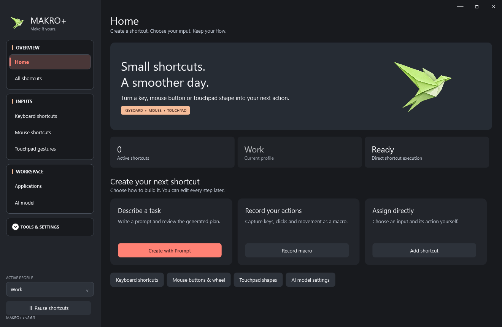

# Makro+

**Small shortcuts. A smoother day.**

An English Windows desktop app for keyboard shortcuts, mouse mappings,
continuous touchpad shapes and editable macros. Describe an action in a prompt,
review its plan, then run it directly with your chosen input.



- **Keyboard + mouse:** combinations, Del+5 prefixes, five mouse buttons and wheel directions.
- **Touchpad shapes:** draw a saved one-finger shape without holding an activation key.
- **Bring your own model:** local GGUF or a compatible chat-completions server.
- **Reviewable actions:** edit steps, apps, text, waits, scripts, profiles and conflicts.
- **Personal appearance:** six presets and importable/exportable custom palettes.
- **Local control:** saved shortcuts need no model request; no account is required.

**Windows 10/11 x64 · .NET Framework 4.8 · GPL-3.0-only · No bundled model weights**

## Download

**[Download Makro+ 2.6.3 for Windows x64](https://github.com/yafermys/MakroPlus/releases/download/v2.6.3/MakroPlus-2.6.3-win-x64.zip)**

[All releases](https://github.com/yafermys/MakroPlus/releases) · [Matching source archive](https://github.com/yafermys/MakroPlus/releases/download/v2.6.3/MakroPlus-2.6.3-source.zip)

Extract the Windows ZIP before running `MakroPlus.exe`.
The matching `.sha256` file verifies the ZIP. GitHub's source archives contain
source code, not a ready-to-run Windows app. This release is unsigned.

Read the complete [offline user guide](packaging/USER_GUIDE.html), including
prompt examples, model setup and every app section. The Windows ZIP contains the
same guide and a `models` folder with instructions. Put your own GGUF there,
or choose one stored elsewhere. Applications can be closed while you create
assignments; register/select their installed executable files.

## Run or install

Extract the complete `release/MakroPlus-2.6.3-win-x64.zip`, then open `MakroPlus.exe`. Use `Install.cmd` for a per-user installation and Start menu/desktop shortcuts. Read `START_HERE.txt` and the complete offline `USER_GUIDE.html` in the package (also Settings → Open user guide). The package includes the llama.cpp runtime, Microsoft-signed Visual C++ installer, licenses, a test summary and SHA-256 manifest. **No language model weights are bundled or automatically downloaded.** This build is unsigned.

The redesigned Home separates prompt creation, macro recording and direct assignment. Everyday input/workspace pages stay visible; secondary tools are grouped under **Tools & settings**. Prompt editing puts the request and preview first, with advanced trigger/app settings collapsed.

## Input sections and appearance

The main window uses a theme-aware custom frame with no native white title bar, including when maximized. Minimize, maximize/restore and close controls remain at the top right. The top edge supports native caption movement and double-click behavior; the maximized window respects the current monitor's taskbar work area. Sidebar navigation has separate framed **OVERVIEW**, **INPUTS**, **WORKSPACE** and **TOOLS & SETTINGS** groups, stronger headings and an accent rail on the active page.

**INPUTS → Keyboard shortcuts** lists keyboard-triggered assignments, including keyboard-triggered macros. Mouse-triggered assignments and touchpad shapes stay in their input sections. Disabled keyboard assignments remain visible and editable. The default source filter shows personal assignments; source filters can also show detected keyboard shortcuts and known defaults. Search, edit, enable/disable and conflict controls are retained.

Open **Tools & settings → Appearance**, or **Settings → Customize appearance**. The gallery offers **Graphite**, **Midnight** and **Forest** dark palettes, plus **Paper**, **Mist** and **Sand** light palettes. The backgrounds, surfaces and hero use the selected neutral, navy, green, cool or warm base palette. Coral and peach are secondary accents for actions, selections and badges. Theme selection applies immediately, persists across restarts and follows exported/imported preferences. Older light/dark settings migrate to Paper/Graphite. Tests check text/action contrast and actual gallery selection/persistence for all six presets.

Select a starting theme, then choose **Create theme**. The designer offers a color picker and editable `#RRGGBB` fields for backgrounds, cards/sidebar, controls, text, secondary text, borders, selections, primary accent/button text, peach accent and home banner. It previews changes without applying them until **Save and apply**. Give the palette a name and choose its light/dark classification. Invalid color values cannot be saved; a persistence failure keeps edits available for retry.

Custom themes appear alongside presets. Select one to **Edit selected** or **Delete selected**; presets are preserved. **Export selected** writes a palette-only `.makrotheme.json` file, and **Import theme** adds an independently identified copy shared by someone else. No account or online service is required. Theme files contain colors and names, without shortcuts, API keys or model settings. Imports validate format, version and opaque color values; they cannot overwrite built-in theme identities. Settings transfers also preserve custom palettes, resolving identity collisions so existing colors are kept. Invalid stored palettes fall back to a preset at startup.

## Recommended model

**[Qwen3.5-4B Q4_0 GGUF — download and setup](docs/RECOMMENDED_MODEL.md)**

This is the approximately **2.58 GB** Unsloth GGUF file used in development
verification. The linked file's SHA-256 matches the tested local model. Copy it
into `models`, select it in **AI model → Configure model**, then generate a
preview. The first request loads it; saved shortcuts run without another model
request. This recommendation is optional; compatible alternatives remain available.

**[Download the verified model](https://huggingface.co/unsloth/Qwen3.5-4B-GGUF/resolve/e87f176479d0855a907a41277aca2f8ee7a09523/Qwen3.5-4B-Q4_0.gguf?download=true)**

No model weights are included in the repository or release ZIP. The model has
its own Apache-2.0 license; Makro+ source uses GPL-3.0-only. Local memory usage
includes runtime/context overhead beyond the model file size.

## Bring your own model

Open **AI model → Configure model**, or **Change model** in the prompt editor. Choose an instruction-following **local GGUF file** or an **OpenAI-compatible chat-completions server**. Local filenames, model families, server addresses and API model IDs are not restricted to a named model or provider. GGUF architecture support depends on the shipped llama.cpp version; server support requires the standard chat-completions response shape. Quality and JSON instruction following vary by model.

The package includes a `models/README.txt` folder beside the executable. Copy your downloaded GGUF there; Open models folder and Refresh models folder are available in model settings. A single file is discovered automatically when no file was selected; multiple files require an explicit choice. Selections inside models use relative paths so the whole app can be moved. External selections remain absolute; a missing chosen file is never silently replaced.

Local mode uses the model's embedded chat template. The first request loads it; subsequent requests reuse the session and prompt cache. GPU startup failures fall back to CPU. Optional Fast planning disables reasoning for local models; users can turn it off. No Qwen-specific template arguments are sent. Server mode uses the exact configured base URL and model ID, with optional API authentication. Structured mode sends a JSON schema where supported, falling back to JSON-object mode or prompt-only mode on explicit capability rejections. Explicit server rejections of `response_format`, `temperature` and legacy `max_tokens` are negotiated automatically and remembered per endpoint/model/credential. You can also turn structured output off. Full `/chat/completions` URLs are accepted. Maximum output tokens is configurable (256–32768; default 2048), with a clear error when generation is truncated. The JSON contract is supplied and validated, with one correction attempt for malformed or inconsistent plans. Text blocks, one tool/function plan call, fenced JSON, a single JSON object surrounded by prose and leading completed reasoning blocks are accepted. Unknown actions and ambiguous alternatives are rejected. Explicit quoted text, wait durations, literal action order and current-selection copy are checked against the request; unused optional fields are normalized without inventing actions. A relevant example replaces the longer fixed example set.

API keys use Windows DPAPI for the current user and are omitted from exported settings. Prompts and application context are sent to the server selected by the user. No external server is selected by default. Existing model paths migrate as user preferences; missing paths are not silently replaced with another model.

## Responsiveness and playback

Saved shortcuts execute their saved plans without invoking a model. Default inter-step delay is **15 ms**, replacing the previous fixed 100 ms; Settings offers 0/15/50/100/250 ms. Explicit waits and recorded pauses are preserved; no automatic delay follows an explicit wait or the final step. Shortcuts still wait for the activation keys to be released, preventing held modifiers from corrupting output. On key release, pending execution is posted immediately at WPF input priority; the 8 ms timer remains as a fallback and stops when idle. Already-foreground focus steps avoid repeated window enumeration and a redundant 100 ms activation wait. HTTP connections and negotiated API capabilities are reused; responses are bounded to 128 KB and cancellation closes stalled response streams.

History writes are coalesced over 750 ms. A detached byte snapshot is captured on the UI thread and disk I/O, including the durable flush and atomic replacement, runs on a worker. Per-file sequence numbers reject older or duplicate snapshots, so a late history task cannot overwrite a newer configuration save. Capture/write failures keep unsaved history eligible for retry, and closing saves synchronously when necessary after removing the input hooks. Configuration edits remain synchronous and may wait for a write already in progress. A forced process kill can still lose pending history.

Keyboard and mouse hooks still run on the UI thread; this change removes background history disk work from that thread, rather than isolating hooks from every possible UI pause. Unsupported mouse messages, including movement, leave before marshaling. Foreground process lookup is skipped for keys/buttons/wheel inputs with no enabled candidate at the current modifiers, except when a pending prefix needs the own-window pointer check. The executable path and extended-key lookup table are cached. These small hook optimizations are tested by behavior and lookup counts; no reliable per-event microsecond speedup is claimed. Application metadata for prompt requests is prepared off the UI thread, and dashboard statistics avoid rebuilding hidden conflict tables.

The application uses English labels, action names, help, errors, menus, default profiles and numeric formatting. Legacy Turkish action identifiers and built-in profile names migrate when loading settings. User-entered shortcut names, prompts, text, custom profile names and historical content are preserved.

## Continuous touchpad shapes

The **Touchpad gestures** page implements the requested always-listening mode. Drawing and execution do not require an activation key, click, button hold or activation tap.

1. Leave **Continuously recognize touchpad shapes** enabled.
2. Windows Precision Touchpad input is the default source. For a legacy driver, click **Detect my touchpad**, then move only one finger on the touchpad. Calibration selects that Windows pointer device.
3. Click **Add a shape**, enter its name and profile, and choose **Record shape**.
4. Draw a distinct one-finger shape, then pause. Recording starts after a short delay so the button click itself is excluded.
5. Select an existing action or use **Create / edit action**. Review the trace and save.
6. Switch to the target application. Draw the saved shape and pause to run it.

For a prompt-created action, choose **Touchpad gestures → Create with prompt**. Record the activation shape, then click **Describe action with prompt**. Write only the action, for example `Select all text and copy it`, `Press Ctrl+S`, or `Open YouTube in Brave`. The recorded shape is supplied as the trigger to the configured local/API model; no placeholder keyboard trigger is inserted. Review the plan, click **Use this action**, then **Save shape shortcut**. The same prompt option is available when editing existing shapes, preserving their identity and profile while validating the completed shortcut for conflicts.

The rule interpreter also accepts English copy/select/paste commands, text, waits and key sequences without a keyboard trigger in this flow. Keyboard rule examples now support English activation headers and two-key triggers such as Del+5. Quoted text and decimal-comma legacy waits remain preserved.

Raw pointer movement continues normally. Recognition evaluates the stroke after an adjustable pause (600 ms by default). Coordinates are resampled and normalized for scale/position; closed shapes support different start points and directions. Open-shape direction is preserved. Low-confidence, short or ambiguous strokes do not execute. App-specific and profile-specific identical shapes take precedence over shared/global ones. Similar conflicting shapes are detected before saving.

Recognition prepares saved templates when assignments refresh, normalizes each input stroke once and finds the two best matches without sorting the full candidate list. Scope-priority comparisons are reused until the assignments refresh. Recording-preview updates are throttled while retaining the input samples, and the trace is fitted inside its canvas. Keyboard modifiers and physical mouse-button state are checked again before dispatching a recognized shape.

Recognition is suspended inside Makro+, while editing/recording, while keys or buttons are held, during another workflow, and when the shortcut motor is paused. A foreground-window change cancels a stroke. Continuous recognition can be disabled on the page or from the tray.

This feature recognizes **one-finger pointer paths**, not arbitrary raw multi-finger contact gestures. Windows three/four-finger gestures are not replaced. It uses stable Windows Raw Input APIs, with no touchpad driver or OS setting changes. Windows documents that Precision Touchpad mouse input can have a null device handle; older drivers can be selected through calibration. Devices that do not expose raw pointer input require compatible drivers and cannot be guaranteed by this app.

## Keyboard and mouse compatibility

Standard Windows virtual keys work independently of USB, Bluetooth, built-in or PS/2 connection type when the driver exposes normal Windows input. Capture physical input or type names such as `Ctrl+Oem102`, `VolumeUp`, `Ctrl+BrowserBack`, `XButton1` or `Ctrl+WheelUp`. Media/browser key names and all defined Windows Forms key names are recognized in trigger prompts. Displayed key names are English and do not depend on the OS key-name language.

Five standard mouse buttons and four wheel directions are supported. High-resolution wheel deltas accumulate to a 120-unit step, avoiding excessive triggering from small packets. Vendor utilities can expose additional buttons as ordinary keys. Settings contains an opt-in to accept software-remapped keyboard/mouse events; Makro+ output is always excluded to prevent loops. A timed-out stale key state is reconciled so a disconnected keyboard does not leave shortcuts permanently waiting.

Firmware-only Fn keys, proprietary HID signals, secure Windows combinations, protected/elevated applications and vendor software remain subject to OS/driver limits. The app does not claim to have been tested on every physical keyboard, mouse, touchpad or driver version. Input devices can be inspected in **Transfer and diagnostics**.

## Macros and existing features

Use **Record macro**; F10 stops recording. Steps can be edited, added, removed, duplicated and reordered. Mouse steps support left/right/middle/X1/X2, position, drag endpoint, hold/drag duration, horizontal/vertical scroll and modifiers. Accessible elements are preferred for suitable short clicks; optional proportional positioning adapts other points to window size. A covered point or foreground-window change stops playback. Escape cancels remaining work, releasing held mouse buttons/modifiers.

Profiles, app/global scope, conflict checks, a non-activating shortcut guide, themes, tray controls, history, application registration, browser/native-app links, Windows `.lnk` and VS Code shortcut scanning/editing are retained. Global scope and All profiles are separate choices. Windows shortcut-file hotkeys cannot use mouse or shape triggers; those are personal Makro+ mappings.

The prompt planner uses the model selected by the user. Plans support keys, text, waits, accessible buttons, focus, application/resource opening and scripts; there is no application-name whitelist. Previewing never executes the plan. Missing trigger information becomes a clear question. App results and video playback are not automatically verified.

## Data and transfer

The settings location remains `%LOCALAPPDATA%/AkilliKisayol/settings.json`. Writes are atomic, with a previous-version `.bak`; malformed data is preserved separately before recovery. The recovered motor starts paused. Existing user settings are not overwritten by tests.

Export/import includes shortcuts, profiles, saved shapes and preferences. Match application paths on the new computer; recalibrate a device-specific legacy touchpad source as needed. Existing assignments are preserved, and invalid/conflicting imports remain disabled. External application shortcut files are rescanned on the destination computer. Uninstall preserves settings and exported data.

## Build and tests

```powershell
.\setup-runtime.ps1
.\test.ps1 -OutputDirectory dist\makroplus-2.6.3
# Headless, no desktop input (also runs in GitHub Actions):
Start-Process -FilePath .\dist\makroplus-2.6.3\MakroPlus.exe -ArgumentList '--persistence-test' -WindowStyle Hidden -Wait
Get-Content .\dist\makroplus-2.6.3\persistence-test-results.json
.\verify-models.ps1 -OutputDirectory dist\makroplus-2.6.3
.\verify-compatibility.ps1 -ModelPaths @('C:\models\first.gguf','C:\models\second.gguf')
.\publish.ps1 -Archive -SkipBuild
```

Compilation uses the installed .NET Framework C# compiler; no .NET SDK is required. `--self-test` covers existing features plus shape normalization/matching/ambiguity, no-key continuous execution, profile/app precedence, recording/edit/save UI, persistence/transfer/migration, high-resolution wheel packets, optional software remaps, playback loop prevention, stale key recovery and input device enumeration. Native click/keyboard tests use controlled test windows. A denied foreground permission is reported as SKIP rather than sending input to another application.

Real-model tests (`--device-model-test`, `--llm-test`, `--features-model-test`, `--app-model-test`, `--activation-model-test`, `--server-model-test`, `--gesture-model-test`) cover 20 scenarios: forced GPU-start failure with actual CPU inference, session reuse, mouse input prompts, keyboard/text/waits, preferences, Spotify/Discord, missing triggers, video timestamps, a custom API model with/without structured output, and touchpad actions including a browser target with no keyboard trigger. They generate plans without running their actions. The available user-supplied model is used locally and through a controlled compatible API; this is not a claim that every third-party model/server has been physically tested.

Version 2.6 additionally tests Qwen2.5-1.5B-Instruct Q4_K_M, SmolLM2-1.7B-Instruct Q4_K_M and Qwen3.5-4B Q4_0, each locally and through a controlled llama.cpp compatible API (7 cases per mode, 42 total). Cases cover select/copy, exact typed text and wait/action order, mouse triggers, touchpad actions, missing triggers, selected browsers and structured output disabled. API fixtures also cover response dialects, cached parameter negotiation, authentication rejection, oversized/stalled responses and cancellation. Test-only weights stay outside the release. Performance reports distinguish synthetic release-to-callback latency from model planning and real application startup; no universal latency or model-quality guarantee is implied.

The general check also covers parent/child prompt dialogs, editing existing shape actions without self-conflicts, restoring the input engine after closing, custom-theme metadata collisions, window controls and persistence. Conflict comparisons are grouped by their first trigger key before applying the existing scope/profile/sequence rules; a 2,100-assignment stress fixture checks 100 deliberate overlaps. List pages count conflict matches in one pass, and hidden lists are not rebuilt on unrelated pages. Rule clause splitting normalizes the input once instead of repeatedly processing its suffixes. Loaded local-model sessions avoid redundant startup probes; initial health probes are individually bounded and cancellable. Test and performance summaries are included in the package.

Automated raw-event and recognizer tests do not prove correct physical behavior on every touchpad. This development computer is the only physical device used for verification. The package includes the actual test summary and file hashes.

## Windows API references

- [Raw Input overview](https://learn.microsoft.com/en-us/windows/win32/inputdev/about-raw-input)
- [RAWINPUTHEADER and Precision Touchpad device handles](https://learn.microsoft.com/en-us/windows/win32/api/winuser/ns-winuser-rawinputheader)
- [Touchpad input behavior](https://learn.microsoft.com/en-us/windows/apps/develop/input/touchpad-interactions)
- [Windows Precision Touchpad HID collection](https://learn.microsoft.com/en-us/windows-hardware/design/component-guidelines/touchpad-windows-precision-touchpad-collection)
- [Mouse button/wheel input](https://learn.microsoft.com/en-us/windows/win32/api/winuser/ns-winuser-msllhookstruct)
- [llama.cpp releases](https://github.com/ggml-org/llama.cpp/releases)

## Closed applications and offline guide

Creating direct or prompt assignments does not require the destination/scope application to run. Register closed apps using their executable files; registered entries remain visible in the picker. At execution time, scoped triggers require the scope in the foreground and UI actions require a target window. Use a Global Open application → Focus → UI actions workflow to launch before interacting.

`USER_GUIDE.html` covers installation, models and API setup, direct/prompt examples, scope versus destination, keyboard/mouse/touchpad, macro recording/editing, profiles/preferences, conflicts and detected shortcuts, themes, settings, cancellation/history, transfer and troubleshooting. It has a linked contents list, no remote assets/scripts and a print layout. `--model-folder-test` verifies real inference from an auto-discovered models folder and a relative selection, plus closed-app launch/scoped planning without launching the target.

## License and contributions

Copyright (C) 2026 Makro+ contributors. This project is licensed under **GPL-3.0-only**; see [LICENSE](LICENSE). Independent runtime components and models keep their own licenses; see [THIRD_PARTY_NOTICES.md](THIRD_PARTY_NOTICES.md). Contributions and issue reports are welcome: read [CONTRIBUTING.md](CONTRIBUTING.md), [SECURITY.md](SECURITY.md) and [CHANGELOG.md](CHANGELOG.md).

The Windows build workflow compiles source, checks publication contents and runs headless storage-ordering/metadata tests. Native input/desktop tests are run on an interactive Windows desktop; CI compilation alone is not a hardware or model-compatibility guarantee.
